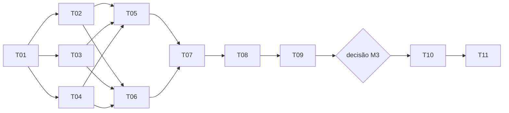

# Tarefas 0001: esqueleto Java da captura

- Plano base: [0001-esqueleto-captura.md](0001-esqueleto-captura.md) (citado abaixo como "Plano §N")
- ADR: [0001-captura-raw-pncp.md](../adr/0001-captura-raw-pncp.md)

Cada tarefa é autocontida: um executor sem histórico lê as regras, o contrato de interfaces e a própria tarefa, mais as seções indicadas em "Ler".

## Regras para o executor

1. Leia só o que a tarefa lista em "Ler". Não leia o plano inteiro.
2. Crie ou altere só os arquivos listados em "Arquivos".
3. Siga o contrato de interfaces ao pé da letra. Se ele for insuficiente ou estiver errado, pare e relate; não o altere por conta própria.
4. Entregue código completo: sem stubs, sem `TODO`, sem métodos vazios.
5. Testes cobrem comportamento observável. A API falsa é um `com.sun.net.httpserver.HttpServer` em porta 0. Nenhum teste toca a API real.
6. Só tarefas marcadas **API real** chamam `pncp.gov.br`, com concorrência de no máximo 3.
7. Build: `mvn -q -f captura/pom.xml test`. Em onda paralela, **não rode o Maven**; quem integra roda uma vez ao fim da onda e devolve as falhas a quem escreveu o arquivo. Em tarefa sequencial, rode e entregue verde.
8. Nomes de domínio em português, como no contrato. `codigoUnidade` é sempre `String`.

## Ondas



| Onda | Tarefas | Execução | Marco |
|---|---|---|---|
| 0 | T01 | sequencial | M1 |
| 1 | T02, T03, T04 | paralela | M1 |
| 2 | T05, T06 | paralela | M1 |
| 3 | T07 | sequencial, integra M1 | M1 |
| 4 | T08 | sequencial | M2 |
| 5 | T09 | sequencial, longa | M2 |
| — | decisão do mantenedor (Plano §1, item 3) | — | — |
| 6 | T10 | sequencial | M3 |
| 7 | T11 | sequencial | M3 |

## Contrato de interfaces

Pacote base `oracle.captura`. Tipos marcados com a tarefa que os cria.

```java
// oracle.captura — T01
public enum Modo { BACKFILL, INCREMENTAL }

public final class ConfigInvalida extends RuntimeException {
  public ConfigInvalida(String mensagem);
}

public record Config(
    String recurso, Modo modo, Path raiz,            // raiz absoluta
    LocalDate janelaInicio, LocalDate janelaFim,     // ambas nulas ou ambas presentes
    String uf, List<Integer> modalidades,
    int concorrencia, int sobreposicaoDias, Duration timeout,
    int maxTentativasHttp, Duration backoffBase, Duration backoffTeto,
    URI baseConsulta, URI basePncp) {
  public static final ZoneId FUSO = ZoneId.of("America/Sao_Paulo");
  public static Config doAmbiente(Map<String, String> ambiente);   // lança ConfigInvalida
}

public final class Json {
  public static final ObjectMapper MAPPER;   // JavaTimeModule; datas como texto ISO
}

// oracle.captura — T06
public final class Aplicacao {
  public static int executar(Config config, Clock relogio);   // 0 concluído, 1 fatal
}

public final class Coordenador {
  public record Resumo(int ok, int vazias, int falhas) {}
  public Coordenador(Config config, Recurso recurso, RepositorioEstado repositorio,
                     Contexto contexto, LocalDate hoje);
  public Resumo executar() throws IOException;
}

// oracle.captura.estado — T01
public enum Status { PENDENTE, OK, VAZIA, FALHA }

public record RegistroUnidade(
    Status status, int tentativas, Instant atualizadoEm, LocalDate dataCaptura,
    int paginas, int registros, String caminho, String erro) {}

public final class Estado {                       // POJO mutável; só o coordenador altera
  public int versao = 1;
  public LocalDate watermarkContratacoes;         // nulo = nunca capturado
  public LocalDate inicioBackfillContratos;
  public Map<String, LocalDate> watermarkContratos = new TreeMap<>();      // "cnpj/codigoUnidade"
  public Map<String, RegistroUnidade> unidadesCaptura = new TreeMap<>();   // id da UnidadeCaptura
}

// oracle.captura.estado — T02
public final class RepositorioEstado {
  public RepositorioEstado(Path arquivo);
  public Estado carregar() throws IOException;    // arquivo ausente → Estado vazio
  public void gravar(Estado estado) throws IOException;   // tmp + fsync + rename atômico
}

// oracle.captura.http — T01
public record Resposta(URI url, int status, byte[] corpo, Instant recebidaEm) {}

public final class FalhaHttp extends Exception {
  public FalhaHttp(String mensagem, Throwable causa);
}

// oracle.captura.http — T03
public final class ClientePncp {
  public ClientePncp(Duration timeout, int maxTentativas, Duration backoffBase, Duration backoffTeto);
  public Resposta get(URI url) throws FalhaHttp;  // devolve só 200 ou 204
}

// oracle.captura.recurso — T01
public record UnidadeCaptura(String recurso, SequencedMap<String, String> chave) {
  public String id();                             // "contratacoes/dia=2026-11-10/modalidade=8"
  public static UnidadeCaptura deId(String id);
}

public record ResultadoUnidade(
    UnidadeCaptura unidade, Status status, int paginas, int registros,
    String caminho, String erro) {}

// oracle.captura.bronze — T04
public final class EscritorBronze {
  public EscritorBronze(Path raiz, LocalDate dataCaptura, String runId);
  public Path caminhoFinal(UnidadeCaptura unidade);               // absoluto
  public Sessao abrir(UnidadeCaptura unidade) throws IOException;
  public static void limparTmp(Path raiz) throws IOException;

  public final class Sessao {
    public void gravarPagina(int numero, Resposta resposta,
                             SequencedMap<String, String> parametros) throws IOException;
    public String concluir() throws IOException;  // rename atômico; caminho relativo à raiz
    public void descartar();                      // apaga o temporário; não lança
  }
}

public final class LeitorBronze {
  // campo "corpo" de cada pagina-*.json.gz do diretório, em ordem de nome
  public static List<JsonNode> corpos(Path diretorioUnidade) throws IOException;
}

// oracle.captura.recurso — T05
public interface Recurso {
  String nome();
  boolean usaJanela();
  List<UnidadeCaptura> planejar(Config config, Estado estado, LocalDate hoje);  // pode lançar ConfigInvalida
  ResultadoUnidade capturar(UnidadeCaptura unidade, Contexto contexto);         // não lança; falha vira FALHA
  int contarRegistros(JsonNode corpo);
  void concluir(Config config, Estado estado, LocalDate hoje,
                List<ResultadoUnidade> resultados) throws IOException;
}

public record Contexto(Config config, ClientePncp http, EscritorBronze bronze) {}

public final class Recursos {
  public static Recurso porNome(String nome);     // lança ConfigInvalida se desconhecido
}

public final class Paginador {
  public static ResultadoUnidade capturar(
      UnidadeCaptura unidade, URI endpoint, SequencedMap<String, String> parametros,
      int tamanhoPagina, Recurso recurso, Contexto contexto);
}

// oracle.captura.recurso — T08
public record UnidadeOrgao(String cnpj, String codigoUnidade, String nomeUnidade,
                           String uf, String ibge, boolean statusAtivo) {
  public String chavePar();                       // cnpj + "/" + codigoUnidade em URL-encode
}

public final class CatalogoUnidades {
  public static List<UnidadeOrgao> ler(Path raiz) throws IOException;   // ausente → lista vazia
  public static void gravar(Path raiz, Collection<UnidadeOrgao> unidades) throws IOException;
}
```

---

## T01 — Scaffold e tipos de dados

- **Depende de:** nada.
- **Ler:** Plano §2, §3, §5.
- **Arquivos:**
  - `.gitignore`
  - `captura/pom.xml`
  - `captura/src/main/java/oracle/captura/{Modo,ConfigInvalida,Config,Json}.java`
  - `captura/src/main/java/oracle/captura/estado/{Status,RegistroUnidade,Estado}.java`
  - `captura/src/main/java/oracle/captura/http/{Resposta,FalhaHttp}.java`
  - `captura/src/main/java/oracle/captura/recurso/{UnidadeCaptura,ResultadoUnidade}.java`
  - `captura/src/test/java/oracle/captura/ConfigTest.java`
  - `captura/src/test/java/oracle/captura/recurso/UnidadeCapturaTest.java`
- **Fazer:**
  - `pom.xml`: Java 21 (`maven.compiler.release`), dependências do Plano §2 nas versões estáveis atuais do Maven Central, surefire, shade com `mainClass` `oracle.captura.Main` e `finalName` `captura`.
  - `.gitignore`: `captura/target/` e `data/`.
  - `Config.doAmbiente`: lê as variáveis e os padrões do Plano §3 e faz só a validação de formato. `raiz` vira caminho absoluto. Os valores fixos (6 tentativas, 1 s, 60 s, URLs base `https://pncp.gov.br/api/consulta` e `https://pncp.gov.br/api/pncp`) são preenchidos aqui.
  - `UnidadeCaptura`: cópia imutável do mapa no construtor; `id()` e `deId()` com URL-encode dos valores, preservando a ordem das chaves.
- **Testes:**
  - `Config`: variável obrigatória ausente, modo desconhecido, data ilegível, só uma ponta da janela, início depois do fim, concorrência fora de 2–4, padrões aplicados.
  - `UnidadeCaptura`: `deId(id())` devolve a mesma unidade, inclusive com valor `01` e com valor que contém `/`.
- **Aceite:** build verde.
- **Não fazer:** `Main`, `Aplicacao`, validação recurso × modo × janela (é da T06).

## T02 — Repositório do estado

- **Depende de:** T01.
- **Ler:** Plano §5.
- **Arquivos:**
  - `captura/src/main/java/oracle/captura/estado/RepositorioEstado.java`
  - `captura/src/test/java/oracle/captura/estado/RepositorioEstadoTest.java`
- **Fazer:**
  - `carregar`: arquivo ausente devolve `Estado` vazio; JSON no formato do Plano §5, via `Json.MAPPER`.
  - `gravar`: cria o diretório pai, escreve em arquivo temporário no mesmo diretório, `FileChannel.force(true)`, `Files.move` com `ATOMIC_MOVE` e `REPLACE_EXISTING`.
- **Testes:** ida e volta com watermarks e unidades em todos os status; arquivo ausente; gravar duas vezes deixa só o arquivo final no diretório.
- **Aceite:** entregue sem rodar o Maven (onda paralela).

## T03 — Cliente HTTP

- **Depende de:** T01.
- **Ler:** Plano §7.
- **Arquivos:**
  - `captura/src/main/java/oracle/captura/http/ClientePncp.java`
  - `captura/src/test/java/oracle/captura/http/ClientePncpTest.java`
- **Fazer:** implementar o Plano §7 com `java.net.http.HttpClient`. `InterruptedException` restaura a flag e vira `FalhaHttp`. Log via SLF4J.
- **Testes** (backoff base de 1 ms):
  - 429 → 429 → 200 devolve o corpo e faz 3 chamadas;
  - 500 persistente lança `FalhaHttp` depois de exatamente `maxTentativas` chamadas;
  - 204 devolve status 204 e corpo vazio;
  - 422 lança `FalhaHttp` com uma única chamada;
  - servidor que demora mais que o timeout conta como tentativa e é refeito;
  - 429 com `Retry-After: 1` espera pelo menos 1 s antes da próxima chamada.
- **Aceite:** entregue sem rodar o Maven (onda paralela).

## T04 — Escritor e leitor do bronze

- **Depende de:** T01.
- **Ler:** Plano §6.
- **Arquivos:**
  - `captura/src/main/java/oracle/captura/bronze/{EscritorBronze,LeitorBronze}.java`
  - `captura/src/test/java/oracle/captura/bronze/BronzeTest.java`
- **Fazer:**
  - Diretório final: `raiz/bronze/metadados/{recurso}/data_captura={dataCaptura}/{resto do id}`. Temporário: `raiz/tmp/{runId}/{id}`.
  - Arquivo `pagina-%04d.json.gz` com o envelope do Plano §6; corpo com `writeRawValue`.
  - `concluir` cria os diretórios pais e move com `ATOMIC_MOVE`; devolve o caminho relativo à raiz, com `/`.
  - `limparTmp` apaga `raiz/tmp` recursivamente, se existir.
- **Testes:**
  - gravar 2 páginas e concluir: os arquivos existem no caminho final, o temporário some e `LeitorBronze.corpos` devolve os 2 corpos em ordem;
  - o corpo sai byte a byte igual ao recebido (use um número como `1.50` e um `1E+2`);
  - antes de `concluir`, nada existe no caminho final;
  - `descartar` apaga o temporário e não cria o final;
  - `concluir` com diretório final já existente lança `IOException` e não altera o existente.
- **Aceite:** entregue sem rodar o Maven (onda paralela).

## T05 — Interface de recurso, paginador e contratações

- **Depende de:** T01, T03, T04.
- **Ler:** Plano §4 (inclusive 4.1 e 4.2), §6.
- **Arquivos:**
  - `captura/src/main/java/oracle/captura/recurso/{Recurso,Contexto,Recursos,Paginador,Contratacoes}.java`
  - `captura/src/test/java/oracle/captura/recurso/{PaginadorTest,ContratacoesTest}.java`
- **Fazer:**
  - `Paginador.capturar`: abre a sessão; busca a página 1 com `pagina` e `tamanhoPagina` somados aos parâmetros. 204 na página 1 → descarta e devolve `VAZIA`. 200 → lê `totalPaginas`, busca as páginas 2..N, soma `recurso.contarRegistros(corpo)`, conclui e devolve `OK` com o caminho. `FalhaHttp`, `IOException`, corpo que não é JSON ou 204 em página > 1 → descarta e devolve `FALHA` com a mensagem.
  - `Contratacoes`: `nome()` `contratacoes`; `usaJanela()` verdadeiro; planejamento e conclusão do Plano §4.1 e §4.2; `capturar` monta os parâmetros do Plano §4 e delega ao `Paginador`; `contarRegistros` é o tamanho de `data`.
  - `Recursos.porNome`: registra só `contratacoes`.
- **Testes:**
  - `Paginador` contra a API falsa: 2 páginas → `OK`, 2 arquivos, registros somados; 204 → `VAZIA` sem arquivo; falha na página 2 → `FALHA` e nada no bronze.
  - `Contratacoes.planejar`: backfill de 3 dias × 2 modalidades dá 6 unidades; incremental com watermark e sobreposição 2 começa 2 dias antes do watermark e termina hoje; incremental sem watermark lança `ConfigInvalida`.
  - `Contratacoes.concluir`: o watermark não recua.
- **Aceite:** entregue sem rodar o Maven (onda paralela).
- **Não fazer:** reprocesso de `FALHA`/`PENDENTE` e pulo no mesmo dia (são da T06).

## T06 — Coordenador, aplicação e ponto de entrada

- **Depende de:** T01, T02, T03, T04; contrato de `Recurso`, `Contexto` e `Recursos` (criados pela T05).
- **Ler:** Plano §3 (validação e código de saída), §8.
- **Arquivos:**
  - `captura/src/main/java/oracle/captura/{Coordenador,Aplicacao,Main}.java`
  - `captura/src/test/java/oracle/captura/CoordenadorTest.java`
- **Fazer:**
  - `Coordenador.executar`: os 8 passos do Plano §8, com `ExecutorCompletionService` sobre pool fixo. Exceção inesperada de `capturar` vira `FALHA`.
  - `Aplicacao.executar`: `Recursos.porNome`; validação recurso × modo × janela; trava em `estado/captura.lock` (`tryLock` nulo e `OverlappingFileLockException` contam como ocupada); `EscritorBronze.limparTmp`; carga do estado; `hoje = LocalDate.now(relogio)`; `runId` único; coordenador; log do resumo. `ConfigInvalida`, trava ocupada e `IOException` viram log de erro e saída 1.
  - `Main`: `System.exit(Aplicacao.executar(Config.doAmbiente(System.getenv()), Clock.system(Config.FUSO)))`, com `ConfigInvalida` tratada como saída 1.
- **Testes** (`CoordenadorTest`, com um `Recurso` de teste em memória):
  - unidade `FALHA` no estado e fora da janela é reprocessada;
  - unidade `OK` com `dataCaptura` de hoje não é executada; com `dataCaptura` de ontem, é;
  - `tentativas` aumenta 1 por execução;
  - diretório final já existente no bronze vira `OK` sem chamar `capturar`;
  - exceção em `capturar` vira `FALHA` e as demais unidades terminam;
  - `concluir` é chamado uma vez, depois de todos os resultados.
- **Aceite:** entregue sem rodar o Maven (onda paralela).

## T07 — Integração de M1 e smoke — **API real**

- **Depende de:** T05, T06.
- **Ler:** Plano §3, §11, §13.
- **Arquivos:**
  - `captura/src/test/java/oracle/captura/AplicacaoContratacoesTest.java`
  - correções de build nos arquivos das ondas 1 e 2, se necessárias.
- **Fazer:**
  1. Rodar o build e corrigir falhas de integração.
  2. Teste ponta a ponta contra a API falsa, chamando `Aplicacao.executar` com `Config` construído à mão e `Clock` fixo:
     - backfill de 1 dia com 3 modalidades: uma com 2 páginas, uma 204, uma com 500 persistente. Esperado: saída 0; estado com `OK`, `VAZIA` e `FALHA`; bronze só da primeira; watermark no fim da janela.
     - incremental no dia seguinte com a modalidade antes falha agora respondendo 200: ela vira `OK`.
     - backfill sem janela e incremental com janela: saída 1.
     - segundo processo com a trava ocupada: saída 1.
  3. `mvn -q -f captura/pom.xml package` e smoke real: backfill de contratações de ontem, `CAPTURA_RAIZ=data`, modalidades padrão.
- **Aceite:** build verde; smoke com saída 0. Relatar: unidades por status, latência por requisição com janela de 1 dia, quantidade de 429 e se `Retry-After` apareceu, e a saída de `zcat` de uma página mostrando o envelope.

## T08 — Recurso unidades e catálogo

- **Depende de:** T07.
- **Ler:** Plano §4.1, §4.2, §9; ADR, seção "Fatos medidos na API (2026-11-12)", linhas sobre `/unidades` e `codigoUnidade`.
- **Arquivos:**
  - `captura/src/main/java/oracle/captura/recurso/{Unidades,UnidadeOrgao,CatalogoUnidades}.java`
  - `captura/src/main/java/oracle/captura/recurso/Recursos.java` (registrar `unidades`)
  - `captura/src/test/java/oracle/captura/recurso/{UnidadesTest,CatalogoUnidadesTest}.java`
  - `captura/src/test/java/oracle/captura/AplicacaoUnidadesTest.java`
- **Fazer:**
  - `Unidades`: `usaJanela()` falso. `planejar` conforme Plano §4.1, lendo o bronze com `LeitorBronze` a partir do `caminho` das unidades `contratacoes/…` com status `OK`. `capturar` faz um `GET` em `{basePncp}/v1/orgaos/{cnpj}/unidades` e grava uma página; 204 → `VAZIA`; 200 → `OK`, mesmo com array vazio. `contarRegistros` é o tamanho do array. `concluir` reescreve o catálogo conforme Plano §9.
  - `UnidadeOrgao` a partir da resposta: `orgao.cnpj`, `codigoUnidade`, `nomeUnidade`, `municipio.uf.siglaUF`, `municipio.codigoIbge`, `statusAtivo`.
  - `CatalogoUnidades`: `catalogo/unidades.jsonl` sob a raiz; escrita atômica e ordenada.
- **Testes:**
  - `planejar`: CNPJs distintos de duas unidades de contratações; incremental ignora CNPJ já `OK` ou `VAZIA`; backfill inclui todos; unidade de contratações `VAZIA` ou `FALHA` não é lida.
  - catálogo: filtra pela UF configurada; códigos `01` e `1` do mesmo CNPJ viram duas linhas; ida e volta de `gravar`/`ler`.
  - ponta a ponta na API falsa: run de contratações seguido de run de unidades gera o bronze de unidades e o catálogo esperado; run de unidades com janela informada dá saída 1.
- **Aceite:** build verde.

## T09 — Backfill real e medição do catálogo — **API real**, longa

- **Depende de:** T08.
- **Ler:** Plano §13; ADR, seção "Em aberto", itens 2, 3 e 4.
- **Arquivos:** `docs/adr/0001-captura-raw-pncp.md` (só acrescentar uma seção de fatos medidos com a data do dia).
- **Fazer:**
  1. Backfill de contratações dos últimos 3 meses, `CAPTURA_RAIZ=data`, como processo em segundo plano sem limite de tempo. Se sobrarem `FALHA`, rodar um incremental para refazê-las.
  2. Backfill de `unidades`.
  3. Medir com DuckDB ou `jq`: CNPJs distintos; linhas do catálogo; pares por município (os 10 maiores); órgãos com unidades fora de GO; modalidades que só devolveram `VAZIA`; duração total; quantidade de 429 e presença de `Retry-After`.
  4. Registrar esses números no ADR como fatos medidos.
- **Aceite:** estado sem `PENDENTE`; números relatados e gravados no ADR.
- **Não fazer:** alterar decisões do ADR. A escolha entre par, CNPJ ou varredura nacional é do mantenedor.

## T10 — Recurso contratos

- **Depende de:** T09 e da decisão do mantenedor (Plano §1, item 3). Esta tarefa vale para a opção "por par".
- **Ler:** Plano §4 (inclusive 4.1 e 4.2), §5; ADR, seções "Unidade de captura e idempotência" e "Incremental".
- **Arquivos:**
  - `captura/src/main/java/oracle/captura/recurso/Contratos.java`
  - `captura/src/main/java/oracle/captura/recurso/Recursos.java` (registrar `contratos`)
  - `captura/src/test/java/oracle/captura/recurso/ContratosTest.java`
  - `captura/src/test/java/oracle/captura/AplicacaoContratosTest.java`
- **Fazer:** `usaJanela()` verdadeiro. Chave da unidade na ordem `cnpj`, `unidade`, `janela` (`yyyyMMdd-yyyyMMdd`). Planejamento e conclusão do Plano §4.1 e §4.2, lendo os pares com `CatalogoUnidades.ler`. `capturar` monta os parâmetros do Plano §4 e delega ao `Paginador`.
- **Testes:**
  - backfill: uma unidade por par, com a janela inteira; catálogo vazio lança `ConfigInvalida`;
  - incremental: par com watermark começa em watermark − sobreposição; par novo começa em `inicioBackfillContratos`; sem `inicioBackfillContratos` lança `ConfigInvalida`;
  - `concluir`: `inicioBackfillContratos` não avança, watermark por par não recua, par com `FALHA` também avança;
  - ponta a ponta na API falsa: backfill com um par com dados, um 204 e um com falha; o incremental seguinte refaz a unidade falha com a janela original e cria a unidade nova de cada par.
- **Aceite:** build verde.

## T11 — Smoke de contratos — **API real**

- **Depende de:** T10.
- **Ler:** Plano §11.
- **Arquivos:** nenhum.
- **Fazer:** em uma raiz separada (`data-smoke`), copiar só o catálogo de `data`, reduzi-lo aos pares de um município pequeno (por `ibge`) e rodar um backfill de contratos de 3 meses.
- **Aceite:** saída 0. Relatar: pares consultados, unidades por status, total de contratos, latência por requisição, e a conferência de que todo registro capturado tem `unidadeOrgao.codigoIbge` igual ao do município.
