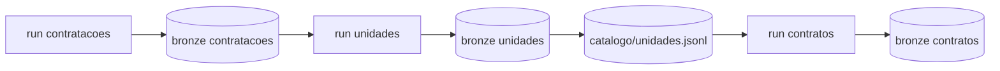

# Plano 0001: esqueleto Java da captura

- Origem: [ADR 0001](../adr/0001-captura-raw-pncp.md), revisão de 2026-11-12
- Tarefas para execução: [0001-esqueleto-captura-tarefas.md](0001-esqueleto-captura-tarefas.md)
- Data: 2026-11-12

O ADR é a fonte das decisões e dos fatos medidos na API. Este plano só acrescenta o que o ADR não fixa (ver §12).

## 1. Escopo e marcos

O esqueleto cobre as três fases de metadados do ADR: contratações, catálogo de unidades e contratos. Fila de arquivos, arquivos, manifesto Parquet e a integração com o Dagster ficam fora, sem stubs.

1. **M1: infraestrutura + contratações.** Primeiro corte de ponta a ponta: configuração, estado, HTTP, bronze, coordenador e o recurso `contratacoes`.
2. **M2: catálogo de unidades.** Recurso `unidades` e o catálogo derivado. O backfill real responde o item 4 do ADR (número de pares `(cnpj, codigoUnidade)` de GO).
3. **Decisão antes de M3.** Com o número de pares medido, confirmar se contratos fica por par, por `cnpjOrgao` ou volta à varredura nacional.
4. **M3: contratos por par**, como está no ADR hoje.

## 2. Stack

| Tema | Escolha |
|---|---|
| Build | Maven, Java 21, módulo único em `captura/`, fat jar (shade) com `finalName` `captura` |
| HTTP | `java.net.http.HttpClient` |
| JSON | Jackson (`jackson-databind` + `jackson-datatype-jsr310`) |
| Log | SLF4J + `slf4j-simple` em stderr |
| Testes | JUnit 5 + `com.sun.net.httpserver.HttpServer` como API falsa |

Pacote base `oracle.captura`, nomes de domínio em português. Sem biblioteca de CLI e sem parsing de argumentos.

## 3. Parâmetros do run

Só variáveis de ambiente. **Um recurso por run**: o Dagster encadeia os três.

| Variável | Obrigatória | Padrão | Uso |
|---|---|---|---|
| `CAPTURA_RECURSO` | sim | — | `contratacoes`, `unidades` ou `contratos` |
| `CAPTURA_MODO` | sim | — | `backfill` ou `incremental` |
| `CAPTURA_RAIZ` | sim | — | diretório com `bronze/`, `catalogo/`, `estado/`, `tmp/` |
| `CAPTURA_JANELA_INICIO`, `CAPTURA_JANELA_FIM` | backfill de contratações e contratos | — | `YYYY-MM-DD`, inclusivas |
| `CAPTURA_UF` | não | `GO` | filtro de contratações e do catálogo |
| `CAPTURA_MODALIDADES` | não | `1,2,…,14` | códigos iterados em contratações |
| `CAPTURA_CONCORRENCIA` | não | `3` | tamanho do pool, de 2 a 4 |
| `CAPTURA_SOBREPOSICAO_DIAS` | não | `2` | só em incremental |
| `CAPTURA_TIMEOUT_S` | não | `90` | por requisição; a latência medida chegou a 38 s |

Validação em duas camadas:

- `Config.doAmbiente` valida formato: obrigatórias presentes, modo conhecido, datas legíveis, as duas pontas da janela juntas ou nenhuma, início ≤ fim, concorrência de 2 a 4.
- `Aplicacao` valida recurso × modo × janela: recurso desconhecido é erro; recurso que usa janela exige janela em backfill e a proíbe em incremental; recurso que não usa janela (`unidades`) a proíbe sempre.

Fixos no código, sem variável: 6 tentativas HTTP, backoff base de 1 s e teto de 60 s, URLs base da API.

"Hoje" e `data_captura` usam o fuso `America/Sao_Paulo`, o mesmo dos timestamps da API.

Código de saída: 0 = run concluído e estado gravado, mesmo com unidades `FALHA`; 1 = erro fatal (configuração inválida, trava ocupada, erro de E/S no estado).

## 4. Recursos



| Recurso | Endpoint | Chave da unidade de captura | Página | Usa janela |
|---|---|---|---|---|
| `contratacoes` | `/api/consulta/v1/contratacoes/publicacao` | `dia`, `modalidade` | 50 | sim |
| `unidades` | `/api/pncp/v1/orgaos/{cnpj}/unidades` | `cnpj` | sem paginação | não |
| `contratos` | `/api/consulta/v1/contratos` | `cnpj`, `unidade`, `janela` | 500 | sim |

Parâmetros de consulta:

- `contratacoes`: `dataInicial` = `dataFinal` = dia em `yyyyMMdd`, `codigoModalidadeContratacao`, `uf`, `pagina`, `tamanhoPagina=50`.
- `contratos`: `dataInicial`, `dataFinal` (pontas da janela em `yyyyMMdd`), `cnpjOrgao`, `codigoUnidadeAdministrativa`, `pagina`, `tamanhoPagina=500`.
- `unidades`: nenhum; a resposta é um array JSON sem paginação.

### 4.1 Planejamento por recurso

`planejar` devolve só as unidades de captura da janela do run. O reprocesso de `FALHA`/`PENDENTE` e o pulo de unidades já feitas hoje são do coordenador (§8).

- **Contratações, backfill:** dias da janela informada × modalidades.
- **Contratações, incremental:** dias de `watermarkContratacoes − sobreposição` até hoje × modalidades. Sem watermark, erro de configuração.
- **Unidades:** lê o bronze das unidades de captura `contratacoes/…` com status `OK` no estado e extrai os `data[].orgaoEntidade.cnpj` distintos. Em incremental, só os CNPJs sem `unidades/cnpj=…` com status `OK` ou `VAZIA`; em backfill, todos (relista órgãos já conhecidos).
- **Contratos, backfill:** um item por par do catálogo, com a janela informada inteira. Catálogo ausente ou vazio é erro de configuração.
- **Contratos, incremental:** por par, de `watermark do par − sobreposição` até hoje. Par sem watermark começa em `inicioBackfillContratos`; se esse campo não existe, erro de configuração.

### 4.2 Conclusão por recurso

`concluir` roda na thread do coordenador, depois de todos os resultados.

- **Contratações:** `watermarkContratacoes = max(atual, fim)`, onde fim é o fim da janela em backfill e hoje em incremental.
- **Unidades:** reescreve o catálogo (§9).
- **Contratos:** em backfill, `inicioBackfillContratos = min(atual, início da janela)`. Nos dois modos, para cada unidade de captura planejada, `watermarkContratos[par] = max(atual, fim da janela da unidade)`.

O watermark avança mesmo quando há `FALHA`: a unidade falha fica no estado e é refeita com a própria chave no run seguinte.

## 5. Estado

Arquivo `estado/captura.json`, escrito só pelo coordenador, em arquivo temporário + `fsync` + rename atômico.

```json
{
  "versao": 1,
  "watermarkContratacoes": "2026-11-12",
  "inicioBackfillContratos": "2026-08-12",
  "watermarkContratos": { "01165729000180/2985": "2026-11-12" },
  "unidadesCaptura": {
    "contratacoes/dia=2026-11-10/modalidade=8": {
      "status": "OK",
      "tentativas": 1,
      "atualizadoEm": "2026-11-12T06:10:22Z",
      "dataCaptura": "2026-11-12",
      "paginas": 7,
      "registros": 331,
      "caminho": "bronze/metadados/contratacoes/data_captura=2026-11-12/dia=2026-11-10/modalidade=8",
      "erro": null
    }
  }
}
```

- A chave de `unidadesCaptura` é o id da unidade de captura: `{recurso}/{k1}={v1}/{k2}={v2}`, com os valores em URL-encode. O mesmo texto é o caminho relativo no bronze.
- A chave de `watermarkContratos` é `{cnpj}/{codigoUnidade em URL-encode}`.
- `tentativas` conta execuções da unidade entre runs, não retries HTTP.
- `caminho` é relativo a `CAPTURA_RAIZ` e fica nulo em `VAZIA`, `FALHA` e `PENDENTE`.
- `codigoUnidade` é string em todo o código: `01` e `1` existem como códigos distintos no mesmo órgão.

No código, a unidade de captura é `UnidadeCaptura` e a unidade administrativa do órgão é `UnidadeOrgao`.

## 6. Bronze

```
bronze/metadados/contratacoes/data_captura=D/dia=YYYY-MM-DD/modalidade=N/pagina-0001.json.gz
bronze/metadados/unidades/data_captura=D/cnpj=C/pagina-0001.json.gz
bronze/metadados/contratos/data_captura=D/cnpj=C/unidade=U/janela=YYYYMMDD-YYYYMMDD/pagina-0001.json.gz
```

- **Envelope**, um por página, nesta ordem de campos: `url`, `parametros` (mapa dos parâmetros de consulta), `capturadoEm` (ISO-8601 UTC), `status`, `corpo`. O corpo entra com `JsonGenerator.writeRawValue`, sem re-serializar.
- **Unidade completa ou ausente:** as páginas são gravadas em `tmp/{runId}/{id da unidade}/` e um `Files.move` com `ATOMIC_MOVE` leva o diretório ao bronze. Diretório no bronze significa unidade inteira.
- **204:** não gera arquivo; a unidade vira `VAZIA` no estado.
- **Falha:** o diretório temporário da unidade é apagado. `tmp/` é limpo na partida do processo. O bronze nunca é apagado nem sobrescrito.

## 7. Cliente HTTP

- `GET` com `Accept: application/json` e timeout por requisição.
- 200 e 204 são devolvidos ao chamador.
- 429, 5xx, erro de E/S e timeout: nova tentativa, até o máximo de tentativas. A espera é o `Retry-After` em segundos, se vier; senão, um valor aleatório entre 0 e `min(teto, base × 2^(tentativa−1))`.
- Qualquer outro status (400, 422 etc.) falha de imediato, sem nova tentativa.
- A cada 429, o log registra se `Retry-After` veio ou não. Isso responde o item 3 do ADR.

## 8. Coordenador

Roda na thread principal e é o único que altera e grava o estado.

1. `janela = recurso.planejar(...)`.
2. `pendencias` = entradas do estado desse recurso com status `FALHA` ou `PENDENTE`.
3. `plano` = janela ∪ pendências, sem repetição, menos as que estão `OK` ou `VAZIA` com `dataCaptura` de hoje.
4. Marca todo o plano como `PENDENTE` (preservando `tentativas`) e grava o estado.
5. Reconciliação: unidade cujo diretório final de hoje já existe no bronze vira `OK` sem requisição, com páginas e registros contados dos arquivos. Cobre a morte do processo entre o rename e a gravação do estado.
6. Despacha o resto a um pool fixo de `CAPTURA_CONCORRENCIA` threads: uma unidade de captura por thread, páginas em sequência dentro dela.
7. A cada resultado: incrementa `tentativas`, atualiza a entrada e grava o estado.
8. `recurso.concluir(...)` e grava o estado.

`Aplicacao` envolve isso com a trava de processo (`FileChannel.tryLock` em `estado/captura.lock`; se ocupada, erro fatal), a limpeza de `tmp/` e a carga do estado.

## 9. Catálogo de unidades

- Arquivo `catalogo/unidades.jsonl`, uma `UnidadeOrgao` por linha: `cnpj`, `codigoUnidade`, `nomeUnidade`, `uf`, `ibge`, `statusAtivo`.
- Reescrito inteiro ao fim de cada run de `unidades`: para cada unidade de captura `unidades/cnpj=…` com status `OK` no estado, lê a resposta bruta em `caminho` e seleciona as unidades com `municipio.uf.siglaUF` igual a `CAPTURA_UF`.
- Escrita atômica, ordenada por `(cnpj, codigoUnidade)`.
- É derivado: pode ser reconstruído a partir do bronze e do estado. As unidades de uma cidade são as linhas com aquele `ibge`.

## 10. Estrutura de arquivos

```
captura/pom.xml
captura/src/main/java/oracle/captura/
  Main.java                      lê o ambiente, chama Aplicacao, devolve o código de saída
  Config.java                    record + doAmbiente(Map)
  ConfigInvalida.java
  Modo.java                      enum BACKFILL | INCREMENTAL
  Json.java                      ObjectMapper compartilhado
  Aplicacao.java                 trava, limpeza de tmp, validação recurso × modo × janela
  Coordenador.java               §8
  estado/Status.java
  estado/RegistroUnidade.java
  estado/Estado.java
  estado/RepositorioEstado.java
  http/Resposta.java
  http/FalhaHttp.java
  http/ClientePncp.java          §7
  bronze/EscritorBronze.java     §6
  bronze/LeitorBronze.java
  recurso/Recurso.java           interface
  recurso/Recursos.java          registro nome → Recurso
  recurso/Contexto.java
  recurso/UnidadeCaptura.java
  recurso/ResultadoUnidade.java
  recurso/Paginador.java         páginas 1..totalPaginas; usado por contratações e contratos
  recurso/Contratacoes.java
  recurso/Unidades.java          M2
  recurso/UnidadeOrgao.java      M2
  recurso/CatalogoUnidades.java  M2
  recurso/Contratos.java         M3
data/                            raiz local de dados, fora do git
```

As assinaturas estão no arquivo de tarefas, seção "Contrato de interfaces".

## 11. Verificação

- **Testes permanentes** cobrem comportamento: validação de configuração, ida e volta do estado, retry do cliente HTTP, planejamento por recurso, regras do coordenador e um ponta a ponta por recurso contra a API falsa. Nenhum teste toca a API real.
- **Smoke na API real** ao fim de cada marco, com janela de 1 dia, conferido com `zcat | jq`.
- **Backfill real** de contratações e unidades ao fim de M2, para medir o número de pares.

## 12. Decisões deste plano que não estão no ADR

1. **Um recurso por run.** O encadeamento contratações → unidades → contratos fica no Dagster.
2. **Catálogo fora do bronze, em JSONL.** Evita Parquet no Java e o DuckDB lê direto.
3. **Atualização das unidades.** Em incremental, órgão já conhecido não é relistado; unidades novas dele só entram em um backfill de `unidades`.
4. **Modalidades fixas 1 a 14, configuráveis.** As vazias custam uma requisição e viram `VAZIA`. Responde o item 2 do ADR sem descoberta dinâmica.
5. **Saída 0 com `FALHA`.** O resultado do run se lê pelo estado.
6. **Limpeza de `tmp/`.** "Nada é removido localmente" vale para o bronze; parciais de unidades com falha são apagados.
7. **Timeout de 90 s por requisição**, tratado como 5xx.
8. **Trava de processo**, para o escritor único valer também entre processos.

## 13. Custos e riscos

- **Backfill de contratações:** 92 dias × 14 modalidades = 1.288 unidades de captura, com pelo menos uma requisição cada, mais as páginas extras das ~24 mil contratações. A latência com janela de 1 dia não foi medida; o smoke de M1 mede. Reduzir `CAPTURA_MODALIDADES` às dez que têm dados em GO corta ~370 requisições vazias.
- **Contratos por par:** o número de requisições cresce com o número de pares, e o estado ganha uma entrada por par a cada run. É o motivo da decisão antes de M3.
- **Leitura do bronze em `unidades`:** cada run relê todo o bronze de contratações com status `OK`. É barato no volume do backfill (centenas de arquivos); reavaliar se passar de dezenas de milhares.
