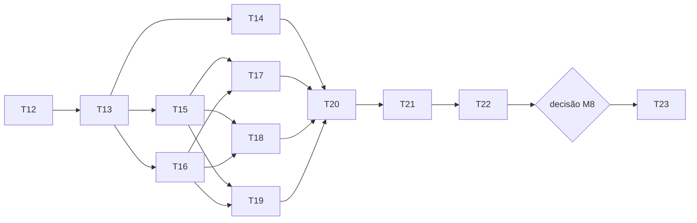

# Tarefas 0002: ritmo, contratos nacionais e arquivos

- Plano base: [0002-contratos-nacionais-e-arquivos.md](0002-contratos-nacionais-e-arquivos.md) (citado abaixo como "Plano §N")
- Plano anterior: [0001-esqueleto-captura.md](0001-esqueleto-captura.md) (citado como "Plano 0001 §N")
- ADR: [0001-captura-raw-pncp.md](../adr/0001-captura-raw-pncp.md)

Cada tarefa é autocontida: um executor sem histórico lê as regras, o contrato de interfaces e a própria tarefa, mais as seções indicadas em "Ler". O código existente em `captura/src/main/java/oracle/captura/` é a referência de estilo.

## Regras para o executor

1. Leia só o que a tarefa lista em "Ler", mais os arquivos Java que ela altera ou usa.
2. Crie ou altere só os arquivos listados em "Arquivos".
3. Siga o contrato de interfaces ao pé da letra. Se ele for insuficiente ou estiver errado, pare e relate; não o altere por conta própria.
4. Entregue código completo: sem stubs, sem `TODO`, sem métodos vazios, sem código morto do desenho anterior.
5. Testes cobrem comportamento observável. A API falsa é um `com.sun.net.httpserver.HttpServer` em porta 0. Nenhum teste toca a API real. Nos testes, os intervalos do `Ritmo` são de milissegundos.
6. Só tarefas marcadas **API real** chamam `pncp.gov.br`, com a concorrência e os intervalos padrão, salvo instrução da tarefa.
7. Build: `mvn -q -f captura/pom.xml test`. Em onda paralela, **não rode o Maven**; quem integra roda uma vez ao fim da onda e devolve as falhas a quem escreveu o arquivo. Em tarefa sequencial, rode e entregue verde.
8. Nomes de domínio em português. `codigoUnidade`, `cnpj` e `ibge` são sempre `String`.
9. Tarefa **API real** longa roda como processo em segundo plano sem limite de tempo, com `stderr` em `data/logs/`.

## Ondas



| Onda | Tarefas | Execução | Marco |
|---|---|---|---|
| 0 | T12 | sequencial | M4 |
| 1 | T13 | sequencial | M5 |
| 2 | T14 | sequencial, longa; pode correr junto das ondas 3 e 4 | M5 |
| 3 | T15, T16 | paralela | M6 |
| 4 | T17, T18, T19 | paralela | M6, M7, M8 |
| 5 | T20 | sequencial, integra; só começa com a T14 encerrada (o `package` troca o jar em uso) | M6–M8 |
| 6 | T21 | sequencial | M6–M8 |
| 7 | T22 | sequencial, longa | M7 |
| — | decisão do mantenedor (Plano §1, item 5) | — | — |
| 8 | T23 | sequencial, longa | M8 |

## Contrato de interfaces

Só o que é novo ou muda. O resto vale como está no código. Tipos marcados com a tarefa que os cria ou altera.

```java
// oracle.captura — T12 (altera)
public record Config(
    String recurso, Modo modo, Path raiz,
    LocalDate janelaInicio, LocalDate janelaFim,
    String uf, List<Integer> modalidades,
    int concorrencia,                                   // 1 a 4
    int sobreposicaoDias, Duration timeout,
    int maxTentativasHttp, Duration backoffBase, Duration backoffTeto,
    Duration intervaloConsulta, Duration intervaloPncp, // novos
    Duration pausa429,                                  // novo; fixo em 120 s em doAmbiente
    long limiteBytes,                                   // novo
    URI baseConsulta, URI basePncp) { … }

// oracle.captura.http — T12
public final class Ritmo {
  // base → intervalo mínimo entre inícios de requisição. A base de uma URL é a chave que é
  // prefixo do texto da URL; URL sem base correspondente não espera nem é penalizada.
  public Ritmo(Map<URI, Duration> intervaloPorBase, Duration pausa429);
  public void aguardar(URI url) throws InterruptedException;  // reserva a próxima vaga da base e dorme até ela
  public void penalizar(URI url, Duration pausa);             // próxima vaga ≥ agora + pausa; pausa nula usa pausa429
}

public final class ClientePncp {
  public ClientePncp(Duration timeout, int maxTentativas, Duration backoffBase,
                     Duration backoffTeto, Ritmo ritmo);                    // T12
  public Resposta get(URI url) throws FalhaHttp;                            // 200 ou 204 (igual a hoje)
  public Resposta get(URI url, boolean aceita404) throws FalhaHttp;         // T16: 200, 204 ou 404
  public Cabecalho head(URI url) throws FalhaHttp;                          // T16: 200 ou 404
  public Download baixar(URI url, Path destino) throws FalhaHttp;           // T16: 200 ou 404
}

// oracle.captura.http — T16
public record Cabecalho(URI url, int status, Long tamanho, String nomeArquivo, Instant recebidaEm) {}
public record Download(URI url, int status, long bytes, String sha256, Instant recebidoEm) {}

// oracle.captura.estado — T13 (altera)
public final class Estado {
  public int versao = 2;
  public Map<String, LocalDate> watermarks = new TreeMap<>();              // nome do recurso → último dia coberto
  public Map<String, RegistroUnidade> unidadesCaptura = new TreeMap<>();
}

// oracle.captura.recurso — T13
public final class JanelaDias {
  // backfill: dias de config.janelaInicio() a janelaFim(); incremental: de
  // watermarks[recurso] − sobreposição até hoje. Incremental sem watermark lança ConfigInvalida.
  public static List<LocalDate> dias(String recurso, Config config, Estado estado, LocalDate hoje);
  // watermarks[recurso] = max(atual, fim); fim = janelaFim em backfill, hoje em incremental
  public static void avancar(String recurso, Config config, Estado estado, LocalDate hoje);
}

// oracle.captura — T15
public final class Jsonl {
  public static <T> List<T> ler(Path arquivo, Class<T> tipo) throws IOException;     // ausente → NoSuchFileException
  public static void gravar(Path arquivo, Collection<?> linhas) throws IOException;  // cria pais; tmp no mesmo diretório + fsync + rename atômico
}

// oracle.captura.recurso — T15
public record ItemFila(
    String tipo, String cnpj, int ano, int seq, String numeroControlePNCP,
    String uf, String ibge, String codigoUnidade) {}

public record Documento(
    String tipo, String cnpj, int ano, int seq, String numeroControlePNCP,
    String uf, String ibge, String codigoUnidade,
    int seqDoc, String titulo, String tipoDocumento, Boolean statusAtivo,
    Long tamanho, String nomeArquivo) {}          // tamanho e nomeArquivo nulos: HEAD devolveu 404

public record LinhaManifesto(
    String numeroControlePNCP, String tipo, String cnpj, int ano, int seq, int seqDoc,
    String titulo, String tipoDocumento, String nomeArquivo,
    String uf, String ibge, String codigoUnidade,
    String caminho, String sha256, long tamanho, Instant capturadoEm) {}

public final class Particoes {
  public static final List<String> TIPOS = List.of("compras", "contratos");
  public static Path fila(Path raiz, String tipo, LocalDate dia);        // raiz/fila/tipo=T/dia=YYYY-MM-DD.jsonl
  public static Path inventario(Path raiz, String tipo, LocalDate dia);  // raiz/inventario/tipo=T/dia=YYYY-MM-DD.jsonl
  public static Path manifesto(Path raiz, String tipo, LocalDate dia);   // raiz/bronze/manifesto/tipo=T/dia=YYYY-MM-DD.jsonl
  // dias × TIPOS, na ordem dos dias; chave da unidade na ordem (tipo, dia)
  public static List<UnidadeCaptura> unidades(String recurso, List<LocalDate> dias);
  // {base}/v1/orgaos/{cnpj}/{tipo}/{ano}/{seq}/arquivos
  public static URI urlListagem(URI basePncp, String tipo, String cnpj, int ano, int seq);
  // urlListagem + "/" + seqDoc
  public static URI urlDocumento(URI basePncp, String tipo, String cnpj, int ano, int seq, int seqDoc);
}

// oracle.captura.bronze — T19 (acrescenta)
public final class EscritorBronze {
  public Path dirTemporario(UnidadeCaptura unidade) throws IOException;  // raiz/tmp/{runId}/{id}, recriado vazio
}

// oracle.captura.recurso — T17, T18, T19
public final class FilaArquivos implements Recurso { static final String NOME = "fila_arquivos"; }
public final class InventarioArquivos implements Recurso { static final String NOME = "inventario_arquivos"; }
public final class Arquivos implements Recurso {
  static final String NOME = "arquivos";
  static String nomeDestino(Documento documento);            // "{seqDoc}-{titulo saneado}[.ext]"
  static Path destino(Path raiz, Documento documento);       // raiz/bronze/arquivos/uf=…/ibge=…/{tipo}/cnpj=…/{ano}/{seq}/{nomeDestino}
}
```

---

## T12 — Ritmo e configuração

- **Depende de:** nada.
- **Ler:** Plano §2, §4; ADR, seção "Fatos medidos na API (2026-11-13)", itens "429" e "Efeito no backfill".
- **Arquivos:**
  - `captura/src/main/java/oracle/captura/Config.java`
  - `captura/src/main/java/oracle/captura/Aplicacao.java`
  - `captura/src/main/java/oracle/captura/http/{Ritmo,ClientePncp}.java`
  - `captura/src/test/java/oracle/captura/http/{RitmoTest,ClientePncpTest}.java`
  - `captura/src/test/java/oracle/captura/ConfigTest.java`
  - todos os testes que chamam `new Config(` ou `new ClientePncp(` (só a adaptação aos construtores novos).
- **Fazer:**
  - `Config`: campos novos na posição do contrato. `CAPTURA_INTERVALO_CONSULTA_MS` (padrão 4000) e `CAPTURA_INTERVALO_PNCP_MS` (padrão 250), inteiros ≥ 0; `CAPTURA_LIMITE_BYTES` (padrão 50000000000), `long` > 0; `pausa429` fixo em 120 s; `CAPTURA_CONCORRENCIA` de 1 a 4.
  - `Ritmo`: por base, o instante da próxima vaga, em `System.nanoTime()`. `aguardar` calcula `vaga = max(agora, próxima)`, grava `próxima = vaga + intervalo` sob trava e dorme fora dela. `penalizar` grava `próxima = max(próxima, agora + pausa)`.
  - `ClientePncp.get`: chama `ritmo.aguardar(url)` antes de cada tentativa. Em 429, chama `ritmo.penalizar(url, Retry-After em segundos ou nulo)` e não dorme por conta própria; o log de `Retry-After` continua. 5xx, erro de E/S e timeout mantêm o backoff atual.
  - `Aplicacao`: monta o `Ritmo` com `baseConsulta → intervaloConsulta` e `basePncp → intervaloPncp`.
- **Testes:**
  - `Config`: concorrência 1 aceita, 0 e 5 recusadas; padrões dos três campos novos; intervalo negativo, limite 0 e valor ilegível recusados.
  - `Ritmo`: 3 chamadas à mesma base com intervalo de 100 ms levam pelo menos 200 ms; 4 chamadas divididas em 2 threads levam pelo menos 300 ms; base diferente não espera pela primeira; `penalizar` de 300 ms atrasa a próxima vaga em pelo menos 300 ms; URL sem base não espera.
  - `ClientePncp`: 429 sem `Retry-After` seguido de 200 espera pelo menos `pausa429` (use 200 ms); depois de um 429 em uma thread, a requisição de outra thread à mesma base também espera. Os testes existentes continuam valendo, inclusive o de `Retry-After: 1`.
- **Aceite:** build verde.

## T13 — Estado versão 2, janela por dias e contratos nacionais

- **Depende de:** T12.
- **Ler:** Plano §5, §6; Plano 0001 §4, §5, §8; ADR, seções "Fases", "Unidade de captura e idempotência" e "Incremental".
- **Arquivos:**
  - `captura/src/main/java/oracle/captura/estado/{Estado,RepositorioEstado}.java`
  - `captura/src/main/java/oracle/captura/recurso/{JanelaDias,Contratacoes,Contratos}.java`
  - `captura/src/test/java/oracle/captura/estado/RepositorioEstadoTest.java`
  - `captura/src/test/java/oracle/captura/recurso/{JanelaDiasTest,ContratacoesTest,ContratosTest}.java`
  - `captura/src/test/java/oracle/captura/{AplicacaoContratacoesTest,AplicacaoContratosTest}.java`
  - `data-smoke/` (remover do repositório com `git rm -r`)
- **Fazer:**
  - `Estado` conforme o contrato. `RepositorioEstado.carregar` lê o JSON como árvore, confere `versao == 2` e só então converte; outra versão lança `IOException` com a versão encontrada e a esperada.
  - `JanelaDias` conforme o contrato.
  - `Contratacoes`: `planejar` usa `JanelaDias.dias` × modalidades; `concluir` usa `JanelaDias.avancar`. Nenhum outro comportamento muda.
  - `Contratos`: reescrever conforme Plano §6. Chave `dia`; `capturar` monta `dataInicial`, `dataFinal` e delega ao `Paginador` com página de 500; `contarRegistros` é o tamanho de `data`. Não lê o catálogo.
  - Apagar os testes do desenho por par; não adaptar asserções sobre `cnpj`, `unidade` e `janela`.
- **Testes:**
  - estado: ida e volta com `watermarks` e unidades em todos os status; arquivo com `"versao": 1` lança `IOException`; arquivo ausente devolve estado vazio na versão 2.
  - `JanelaDias`: backfill devolve os dias da janela, inclusive as pontas; incremental com watermark e sobreposição 2 começa 2 dias antes e termina hoje; incremental sem watermark lança `ConfigInvalida`; `avancar` não recua; watermark de um recurso não afeta o de outro.
  - `Contratacoes`: os casos atuais, sobre `watermarks`.
  - `Contratos.planejar`: backfill de 3 dias dá 3 unidades `contratos/dia=…`; funciona sem `catalogo/`.
  - ponta a ponta na API falsa: backfill de 2 dias, um com 2 páginas e um 204. Esperado: saída 0; `OK` e `VAZIA`; a consulta recebida tem `dataInicial` igual a `dataFinal`, `tamanhoPagina=500` e não tem `cnpjOrgao` nem `uf`; `watermarks.contratos` no fim da janela. Incremental no dia seguinte: planeja de watermark − sobreposição até hoje.
- **Aceite:** build verde; `git ls-files data-smoke` vazio.

## T14 — Backfill real de contratos — **API real**, longa

- **Depende de:** T13.
- **Ler:** Plano §5, §12; ADR, seção "Fatos medidos na API (2026-11-16)".
- **Arquivos:** `docs/adr/0001-captura-raw-pncp.md` (só acrescentar uma seção de fatos medidos com a data do dia).
- **Fazer:**
  1. `mvn -q -f captura/pom.xml package`.
  2. Converter o estado, guardando o original:
     ```sh
     cp data/estado/captura.json data/estado/captura.v1.json
     jq '{versao: 2, watermarks: {contratacoes: .watermarkContratacoes}, unidadesCaptura}' \
       data/estado/captura.v1.json > data/estado/captura.json
     ```
  3. Incremental de `contratacoes` com `CAPTURA_RAIZ=data`.
  4. Backfill de `contratos` com `CAPTURA_JANELA_INICIO=2026-08-13` e `CAPTURA_JANELA_FIM` = hoje. Se sobrarem `FALHA`, rodar um incremental.
  5. Medir com `jq`: dias `OK` e `VAZIA`; páginas e registros no total; registros com `unidadeOrgao.ufSigla = "GO"`; registros sem `ufSigla`; `numeroControlePNCP` repetidos entre dias; bytes do bronze de contratos; duração; quantidade de 429 e de erros de E/S no log; pico de memória do processo (`/usr/bin/time -v`).
  6. Registrar os números no ADR.
- **Aceite:** estado sem `PENDENTE` nem `FALHA` em `contratacoes/` e `contratos/`; números relatados e gravados no ADR.
- **Não fazer:** alterar decisões do ADR; usar `SIGSTOP`/`SIGCONT`. Se o intervalo padrão não bastar, pare e relate.

## T15 — JSONL, registros e partições

- **Depende de:** T13.
- **Ler:** Plano §7, §8, §9 (só os formatos de linha e os caminhos), §10.
- **Arquivos:**
  - `captura/src/main/java/oracle/captura/Jsonl.java`
  - `captura/src/main/java/oracle/captura/recurso/{ItemFila,Documento,LinhaManifesto,Particoes,CatalogoUnidades}.java`
  - `captura/src/test/java/oracle/captura/JsonlTest.java`
  - `captura/src/test/java/oracle/captura/recurso/ParticoesTest.java`
- **Fazer:**
  - `Jsonl`: uma linha por objeto, via `Json.MAPPER`; linhas em branco são ignoradas na leitura. A escrita é a que hoje está em `CatalogoUnidades.gravar` (temporário no mesmo diretório, `force(true)`, `ATOMIC_MOVE` + `REPLACE_EXISTING`, apaga o temporário em erro).
  - `CatalogoUnidades`: `ler` e `gravar` passam a usar `Jsonl`; arquivo ausente continua devolvendo lista vazia; a ordenação continua aqui.
  - `Particoes` conforme o contrato; `cnpj` em URL-encode nas URLs.
- **Testes:**
  - `Jsonl`: ida e volta de `Documento` com `tamanho` e `statusAtivo` nulos; gravar duas vezes deixa só o arquivo final no diretório; lista vazia gera arquivo vazio que se lê como lista vazia; arquivo ausente lança `NoSuchFileException`.
  - `Particoes`: os três caminhos; `unidades` de 2 dias dá 4 unidades com ids `recurso/tipo=compras/dia=…`; as duas URLs.
  - `CatalogoUnidadesTest` continua passando sem alteração.
- **Aceite:** entregue sem rodar o Maven (onda paralela).

## T16 — Cliente HTTP: 404, HEAD e download

- **Depende de:** T13.
- **Ler:** Plano §4; ADR, seção "Fatos medidos na API (2026-11-16)", itens "Arquivo" e "404".
- **Arquivos:**
  - `captura/src/main/java/oracle/captura/http/{ClientePncp,Cabecalho,Download}.java`
  - `captura/src/test/java/oracle/captura/http/ClientePncpArquivosTest.java`
- **Fazer:**
  - Os três métodos novos usam o mesmo laço de tentativas de `get(url)`: `ritmo.aguardar` antes de cada tentativa, 429 penaliza, 5xx/E/S/timeout com backoff, outros status falham de imediato. Extraia o laço; não o copie.
  - `get(url, true)`: 404 é devolvido com o corpo recebido.
  - `head`: método `HEAD`. `tamanho` é o `content-length` (nulo se ausente ou ilegível). `nomeArquivo` é o valor entre aspas de `filename="…"` em `content-disposition`, como veio (nulo se ausente). Em 404, os dois nulos.
  - `baixar`: lê o corpo em streaming com `MessageDigest` SHA-256, gravando em `destino` com `CREATE` + `TRUNCATE_EXISTING`; `sha256` em hexadecimal minúsculo. Erro de E/S no meio do corpo conta como tentativa. Em 404 ou falha final, `destino` não existe ao retornar.
- **Testes:**
  - `get(url, true)` com 404 devolve status 404 em uma única chamada; `get(url)` com 404 continua lançando `FalhaHttp`.
  - `head`: `content-length: 145897` e `content-disposition: attachment; filename="Nota+de+Empenho+3828.pdf"` viram `tamanho` 145897 e `nomeArquivo` `Nota+de+Empenho+3828.pdf`; sem os cabeçalhos, nulos; 404; 429 seguido de 200.
  - `baixar`: corpo de 1 MB em resposta `chunked` chega byte a byte igual, com `bytes` e `sha256` corretos; 500 seguido de 200 deixa só o segundo corpo no arquivo; 404 não deixa arquivo; 500 persistente lança `FalhaHttp` e não deixa arquivo.
- **Aceite:** entregue sem rodar o Maven (onda paralela).

## T17 — Recurso fila de arquivos

- **Depende de:** T15.
- **Ler:** Plano §7; Plano 0001 §8; `recurso/Unidades.java` (padrão de ler o bronze pelo estado).
- **Arquivos:**
  - `captura/src/main/java/oracle/captura/recurso/FilaArquivos.java`
  - `captura/src/test/java/oracle/captura/recurso/FilaArquivosTest.java`
- **Fazer:** `usaJanela()` verdadeiro. `planejar` chama `JanelaDias.dias` (para validar) e devolve lista vazia. `capturar` lança `IllegalStateException`: o recurso não tem unidades. `contarRegistros` devolve 0. `concluir` aplica as regras do Plano §7 aos dias de `JanelaDias.dias`, grava com `Jsonl.gravar` em `Particoes.fila` e chama `JanelaDias.avancar`. Bronze ilegível lança `IOException`.
- **Testes** (estado e bronze montados com `EscritorBronze`):
  - contratações de um dia em duas modalidades `OK` e uma `VAZIA`: a partição de `compras` traz os itens das duas, sem repetição, ordenados;
  - contratos de um dia com registros de GO, de outra UF e sem `ufSigla`: só os de GO entram, com `ano`/`seq` vindos de `anoContrato`/`sequencialContrato`;
  - origem toda `VAZIA`: arquivo vazio;
  - uma modalidade `FALHA`: a partição de `compras` do dia não é gravada e a existente não muda; a de `contratos` do mesmo dia é gravada;
  - dia sem unidade de origem no estado: nada é gravado;
  - `watermarks.fila_arquivos` avança; incremental sem watermark lança `ConfigInvalida`.
- **Aceite:** entregue sem rodar o Maven (onda paralela).

## T18 — Recurso inventário de arquivos

- **Depende de:** T15, T16.
- **Ler:** Plano §8; Plano 0001 §6, §8; `recurso/Unidades.java` (uso de `EscritorBronze.Sessao`).
- **Arquivos:**
  - `captura/src/main/java/oracle/captura/recurso/InventarioArquivos.java`
  - `captura/src/test/java/oracle/captura/recurso/InventarioArquivosTest.java`
- **Fazer:** `usaJanela()` verdadeiro. `planejar` devolve `Particoes.unidades(NOME, JanelaDias.dias(…))`. `capturar` segue os 5 passos do Plano §8, com `Particoes.urlListagem`, `Particoes.urlDocumento`, `get(url, true)` e `head`. Campos da listagem: `sequencialDocumento`, `titulo`, `tipoDocumentoNome`, `statusAtivo` (ausente vira nulo). Corpo 200 que não é array é falha. `gravarPagina` recebe mapa de parâmetros vazio. Resultado `OK`: `paginas` = páginas gravadas, `registros` = documentos. `contarRegistros` é o tamanho do array. `concluir` chama `JanelaDias.avancar`.
- **Testes** (API falsa; fila escrita com `Jsonl.gravar`):
  - 3 itens: um com 2 documentos, um com listagem 204 e um com listagem 404. Esperado: `OK`, 1 página no bronze com o número da posição do item, inventário com 2 linhas trazendo `uf`, `ibge` e `codigoUnidade` do item e `tamanho`/`nomeArquivo` do `HEAD`;
  - `HEAD` com 404 em um documento: a linha existe com `tamanho` e `nomeArquivo` nulos e a unidade é `OK`;
  - listagem de `contratos` sem `statusAtivo`: `statusAtivo` nulo;
  - 500 persistente no segundo item: `FALHA`, nada no bronze, inventário anterior da partição intacto;
  - fila ausente: `FALHA` sem nenhuma requisição; fila vazia: `VAZIA` e inventário vazio gravado;
  - `planejar` em backfill de 2 dias devolve 4 unidades.
- **Aceite:** entregue sem rodar o Maven (onda paralela).

## T19 — Recurso arquivos e manifesto

- **Depende de:** T15, T16.
- **Ler:** Plano §9; Plano 0001 §8.
- **Arquivos:**
  - `captura/src/main/java/oracle/captura/recurso/Arquivos.java`
  - `captura/src/main/java/oracle/captura/bronze/EscritorBronze.java` (só `dirTemporario`; `abrir` passa a usá-lo)
  - `captura/src/test/java/oracle/captura/recurso/ArquivosTest.java`
- **Fazer:**
  - `planejar`: percorre `raiz/inventario/` inteiro, soma `tamanho` sem repetir `(tipo, cnpj, ano, seq, seqDoc)` e lança `ConfigInvalida` com os dois números se a soma passar de `config.limiteBytes()`; registra a soma no log; devolve `Particoes.unidades(NOME, JanelaDias.dias(…))`. Diretório ausente soma 0.
  - `nomeDestino`: título normalizado em NFD sem marcas (`\p{M}`), cada sequência fora de `[A-Za-z0-9._-]` vira `_`, sem `_` nas pontas, cortado em 80 caracteres, `documento` se sobrar vazio. Extensão: o que vem depois do último `.` de `nomeArquivo`, em minúsculas, se casar com `[a-z0-9]{1,8}`; senão, sem extensão.
  - `destino`: conforme o contrato; `ibge` nulo ou vazio vira `_`.
  - `capturar`: os 5 passos do Plano §9. Temporário em `dirTemporario(unidade)`, apagado ao fim. `capturadoEm` da linha recalculada de um arquivo já existente é a data de modificação dele. Manifesto ordenado por `caminho`, gravado com `Jsonl.gravar`. Resultado `OK`: `paginas` 0, `registros` = linhas do manifesto, `caminho` = caminho do manifesto relativo à raiz. Resultado `FALHA`: erro com "N de M documentos falharam" e a primeira mensagem.
  - `contarRegistros` devolve 0. `concluir` chama `JanelaDias.avancar`.
- **Testes** (API falsa; inventário escrito com `Jsonl.gravar`):
  - 2 documentos: arquivos no destino esperado, byte a byte iguais; manifesto com 2 linhas, `sha256` e `tamanho` corretos; temporário vazio;
  - segunda execução da mesma unidade: nenhuma requisição, manifesto igual, inclusive `capturadoEm`;
  - arquivo no destino sem linha no manifesto: nenhuma requisição e linha com o `sha256` do arquivo local;
  - bytes recebidos diferentes do `tamanho`: nada no destino, `FALHA`, e o outro documento da unidade é baixado e entra no manifesto;
  - 404 no download: sem arquivo, sem linha, unidade `OK`; documento com `tamanho` nulo não gera requisição;
  - `planejar` com inventário acima do limite lança `ConfigInvalida`; no limite exato, não;
  - `nomeDestino`: `Nota de Empenho 3828` + `Nota+de+Empenho+3828.pdf` → `1-Nota_de_Empenho_3828.pdf`; título com `/`, acentos e mais de 80 caracteres; `nomeArquivo` nulo → sem extensão; extensão `PDF` → `pdf`.
- **Aceite:** entregue sem rodar o Maven (onda paralela).

## T20 — Integração dos arquivos

- **Depende de:** T14 encerrada, T17, T18, T19.
- **Ler:** Plano §3, §11.
- **Arquivos:**
  - `captura/src/main/java/oracle/captura/recurso/Recursos.java` (registrar os três recursos)
  - `captura/src/test/java/oracle/captura/AplicacaoArquivosTest.java`
  - correções de build nos arquivos das ondas 3 e 4, se necessárias.
- **Fazer:**
  1. Rodar o build e corrigir falhas de integração.
  2. Teste ponta a ponta na API falsa, chamando `Aplicacao.executar` em sequência com `Clock` fixo, backfill de 1 dia: `contratacoes` (2 itens de GO), `contratos` (1 de GO e 1 de outra UF), `fila_arquivos`, `inventario_arquivos`, `arquivos`. Esperado: saída 0 nos cinco; 3 itens na fila; arquivos de GO no destino e ausentes os da outra UF; manifesto com uma linha por arquivo; estado com um watermark por recurso.
  3. No mesmo teste: `arquivos` com `limiteBytes` menor que o inventário dá saída 1 e não baixa; `inventario_arquivos` sem fila dá saída 0 com a unidade `FALHA`; no dia seguinte, depois de `fila_arquivos`, um incremental a refaz.
  4. `mvn -q -f captura/pom.xml package`.
- **Aceite:** build verde.

## T21 — Smoke dos arquivos — **API real**

- **Depende de:** T20.
- **Ler:** Plano §11, §14.
- **Arquivos:** nenhum.
- **Fazer:** com `CAPTURA_RAIZ=data` e `CAPTURA_MODO=backfill`:
  1. `fila_arquivos` com janela de 2026-11-10 a 2026-11-11.
  2. `inventario_arquivos` de 2026-11-10 com o intervalo padrão; de 2026-11-11 com `CAPTURA_INTERVALO_PNCP_MS=100`.
  3. `arquivos` de 2026-11-10, se a soma do inventário couber no limite padrão.
- **Aceite:** saída 0 em todos. Relatar: itens por tipo na fila; documentos por item e bytes por tipo; requisições por segundo, 429 e erros de E/S em cada intervalo; arquivos no disco contra linhas do manifesto; `sha256sum` de 20 arquivos sorteados contra o manifesto; para 5 itens, a conferência de que `uf` e `ibge` do caminho são os de `unidadeOrgao` no bronze de origem.

## T22 — Backfill real do inventário — **API real**, longa

- **Depende de:** T21.
- **Ler:** Plano §12, §14; ADR, seção "Em aberto", item 1.
- **Arquivos:** `docs/adr/0001-captura-raw-pncp.md` (só acrescentar uma seção de fatos medidos com a data do dia).
- **Fazer:**
  1. Backfill de `fila_arquivos` e de `inventario_arquivos` de 2026-08-13 até hoje, com o menor intervalo que passou sem erro na T21. Se sobrarem `FALHA`, rodar um incremental.
  2. Medir com `jq` sobre `data/inventario/`: itens e documentos por tipo; soma de bytes por tipo e no total; média, mediana, percentil 90 e máximo; bytes por extensão e por `tipoDocumento` (os 10 maiores); documentos com `tamanho` nulo; itens sem documento; duração; 429 e erros de E/S.
  3. Registrar os números no ADR.
- **Aceite:** estado sem `PENDENTE` nem `FALHA` em `inventario_arquivos/`; números relatados e gravados no ADR.
- **Não fazer:** rodar `arquivos`. O limite é decisão do mantenedor.

## T23 — Backfill real do download — **API real**, longa

- **Depende de:** T22 e da decisão do mantenedor (Plano §1, item 5). Esta tarefa vale para "baixar tudo com o limite informado".
- **Ler:** Plano §9, §14.
- **Arquivos:** `docs/adr/0001-captura-raw-pncp.md` (só acrescentar fatos medidos).
- **Fazer:**
  1. Backfill de `arquivos` de 2026-08-13 até hoje, com o `CAPTURA_LIMITE_BYTES` decidido. Se sobrarem `FALHA`, rodar um incremental.
  2. Conferir: arquivos no disco contra linhas do manifesto; soma de `tamanho` do manifesto contra `du` de `data/bronze/arquivos`; `sha256sum` de 200 arquivos sorteados contra o manifesto; documentos do inventário sem linha no manifesto, por motivo.
  3. Registrar no ADR: documentos, bytes, duração, taxa média de transferência, 429 e erros de E/S.
- **Aceite:** estado sem `PENDENTE` nem `FALHA` em `arquivos/`; conferências sem divergência; números gravados no ADR.
