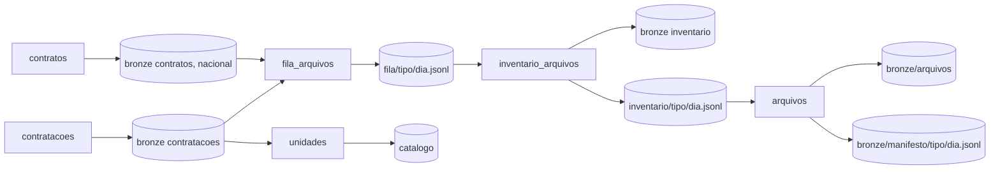

# Plano 0002: ritmo, contratos nacionais e arquivos

- Origem: [ADR 0001](../adr/0001-captura-raw-pncp.md), revisão de 2026-11-16
- Plano anterior: [0001-esqueleto-captura.md](0001-esqueleto-captura.md) (citado como "Plano 0001 §N"). O que ele define e este plano não altera continua valendo.
- Tarefas para execução: [0002-contratos-nacionais-e-arquivos-tarefas.md](0002-contratos-nacionais-e-arquivos-tarefas.md)
- Data: 2026-11-16

O ADR é a fonte das decisões e dos fatos medidos na API. Este plano só acrescenta o que o ADR não fixa (ver §13).

## 1. Escopo e marcos

Cobre o que o Plano 0001 deixou de fora, menos o Dagster, e corrige duas pendências do esqueleto: o ritmo das requisições (fatos de 2026-11-13) e a estratégia de contratos (revisão do ADR de 2026-11-16). Numeração de marcos e tarefas continua a do Plano 0001.

1. **M4: ritmo.** Intervalo mínimo entre requisições por API e pausa global em 429, dentro da captura. Concorrência de 1 a 4.
2. **M5: contratos nacionais por dia.** Estado na versão 2 (um watermark por recurso), janela por dias compartilhada, `Contratos` reescrito, backfill real.
3. **M6: fila de arquivos** (fase 4 do ADR).
4. **M7: inventário** (fase 5a): listagem + `HEAD`. O backfill real responde o item 1 de "Em aberto" do ADR (espaço dos PDFs).
5. **Decisão antes de M8.** Com a soma de bytes medida, o mantenedor fixa `CAPTURA_LIMITE_BYTES` ou reduz o escopo dos documentos.
6. **M8: download e manifesto** (fase 5b).

Fora, sem stubs: Dagster (plano 0003), a exportação do manifesto para Parquet, atas, PCA e `/atualizacao`.

## 2. Parâmetros do run

Mudanças sobre o Plano 0001 §3.

| Variável | Padrão | Mudança |
|---|---|---|
| `CAPTURA_RECURSO` | — | aceita também `fila_arquivos`, `inventario_arquivos` e `arquivos` |
| `CAPTURA_CONCORRENCIA` | `3` | passa a aceitar de 1 a 4 |
| `CAPTURA_INTERVALO_CONSULTA_MS` | `4000` | nova: intervalo mínimo entre inícios de requisição a `/api/consulta` |
| `CAPTURA_INTERVALO_PNCP_MS` | `250` | nova: o mesmo para `/api/pncp` |
| `CAPTURA_LIMITE_BYTES` | `50000000000` | nova: teto de bytes previstos em `bronze/arquivos`; só `arquivos` usa |

Fixo no código: pausa de 120 s em 429 sem `Retry-After`. Origem dos padrões: em `/api/consulta`, 12 requisições em 50 s passaram sem 429 e a recuperação de um 429 levou de 1,5 a 2 min (fatos de 2026-11-13); em `/api/pncp`, 250 ms é um chute conservador que o smoke da T21 mede.

## 3. Recursos



Ordem dos runs do dia: `contratacoes`, `contratos`, `fila_arquivos`, `inventario_arquivos`, `arquivos`. `unidades` fica fora dessa cadeia.

| Recurso | Endpoint | Chave da unidade de captura | Requisições por unidade |
|---|---|---|---|
| `contratos` | `/api/consulta/v1/contratos` | `dia` | páginas de 500 |
| `fila_arquivos` | nenhum | não tem unidades | 0 |
| `inventario_arquivos` | `/api/pncp/v1/orgaos/{cnpj}/{tipo}/{ano}/{seq}/arquivos` e `HEAD .../arquivos/{seqDoc}` | `tipo`, `dia` | 1 por item + 1 por documento |
| `arquivos` | `GET .../arquivos/{seqDoc}` | `tipo`, `dia` | 1 por documento ainda não baixado |

`tipo` é `compras` (contratações) ou `contratos`, igual ao segmento da URL. `dia` é o dia de publicação consultado na origem. Os cinco recursos com janela usam a mesma regra (§5).

## 4. Ritmo e cliente HTTP

- `Ritmo` guarda, por URL base, o instante da próxima requisição permitida. `aguardar(url)` reserva a vaga e dorme até ela; vale para todas as threads e para cada tentativa, inclusive retries.
- 429: `penalizar` empurra a próxima vaga daquela base para agora + `Retry-After`, se veio, ou + 120 s. Não há mais backoff próprio da thread para 429. 5xx, erro de E/S e timeout mantêm o backoff do Plano 0001 §7.
- Métodos novos do cliente, com a mesma política de tentativas:
  - `get(url, aceita404)`: 404 volta ao chamador em vez de virar falha. Item removido do PNCP depois da captura dos metadados não pode travar a unidade para sempre.
  - `head(url)`: devolve `content-length` e o `filename` de `content-disposition`; 404 volta ao chamador.
  - `baixar(url, destino)`: grava o corpo em arquivo, em streaming, e devolve bytes e `sha256`; 404 volta ao chamador.

## 5. Estado versão 2 e janela por dias

```json
{
  "versao": 2,
  "watermarks": { "contratacoes": "2026-11-16", "contratos": "2026-11-16", "fila_arquivos": "2026-11-16" },
  "unidadesCaptura": { "contratos/dia=2026-11-10": { "status": "OK", "...": "..." } }
}
```

- `watermarks` substitui `watermarkContratacoes`, `watermarkContratos` e `inicioBackfillContratos`.
- `carregar` recusa qualquer `versao` diferente de 2 com erro de E/S (saída 1). Não há migração no código: o `data/estado/captura.json` atual é convertido uma vez com `jq` (T14).
- `JanelaDias.dias(recurso, …)`: em backfill, os dias da janela informada; em incremental, de `watermarks[recurso] − sobreposição` até hoje. Sem watermark em incremental, erro de configuração.
- `JanelaDias.avancar(recurso, …)`: `watermarks[recurso] = max(atual, fim)`, com fim = fim da janela em backfill e hoje em incremental. Como no Plano 0001 §4.2, avança mesmo com `FALHA`.
- Crescimento do estado: 14 entradas por dia de contratações, 1 de contratos, 2 de inventário e 2 de arquivos. Cerca de 7 mil por ano.

## 6. Contratos

- Unidade de captura `contratos/dia=YYYY-MM-DD`. Parâmetros: `dataInicial` = `dataFinal` = dia em `yyyyMMdd`, `pagina`, `tamanhoPagina=500`. Sem `cnpjOrgao`, sem `uf`.
- Bronze: `bronze/metadados/contratos/data_captura=D/dia=YYYY-MM-DD/pagina-0001.json.gz`, com a resposta nacional.
- Planejamento: `JanelaDias.dias`. Conclusão: `JanelaDias.avancar`. O catálogo não é lido.
- O `Contratos` por par, seus testes e a raiz `data-smoke/` (saída da T11, com estado na versão 1) são removidos.

## 7. Fila de arquivos (fase 4)

- Recurso sem requisições: `planejar` devolve lista vazia e `concluir`, na thread do coordenador, grava a fila. É o mesmo padrão do catálogo em `Unidades.concluir`.
- Um arquivo por tipo e dia: `fila/tipo={compras|contratos}/dia=YYYY-MM-DD.jsonl`, reescrito de forma atômica. Linha: `tipo`, `cnpj`, `ano`, `seq`, `numeroControlePNCP`, `uf`, `ibge`, `codigoUnidade`.
- Para cada dia da janela e cada tipo:
  - origem de `compras`: unidades `contratacoes/dia=D/modalidade=*` do estado; de `contratos`: `contratos/dia=D`;
  - a partição só é gravada se existe unidade de origem e todas estão `OK` ou `VAZIA`. Com origem `FALHA`, `PENDENTE` ou ausente, a partição anterior fica como está e o log avisa;
  - lê o bronze em `caminho` das unidades `OK`, seleciona `unidadeOrgao.ufSigla = CAPTURA_UF`, elimina repetidos por `(cnpj, ano, seq)` e ordena por essa chave. Origem toda `VAZIA` gera arquivo vazio.
- Campos: `orgaoEntidade.cnpj`; `anoCompra`/`sequencialCompra` ou `anoContrato`/`sequencialContrato`; `numeroControlePNCP`; `unidadeOrgao.ufSigla`, `.codigoIbge`, `.codigoUnidade`.

## 8. Inventário (fase 5a)

Unidade de captura `inventario_arquivos/tipo=T/dia=D`, executada em uma thread:

1. Lê `fila/tipo=T/dia=D.jsonl`. Ausente: `FALHA` (a unidade fica pendente até a fila existir). Vazia: grava o inventário vazio e devolve `VAZIA`.
2. Para cada item, na ordem da fila: `GET` da listagem. 200: grava a resposta como página do bronze (o número da página é a posição do item na fila) e faz `HEAD` em cada documento. 204 ou 404: item sem documentos, sem página.
3. `HEAD` com 404: o documento entra no inventário com `tamanho` e `nomeArquivo` nulos.
4. Qualquer outra falha descarta a unidade inteira (`FALHA`).
5. Grava `inventario/tipo=T/dia=D.jsonl` e só depois move o diretório ao bronze. Se o processo morrer entre os dois passos, a unidade segue `PENDENTE` e é refeita; a reconciliação do Plano 0001 §8 nunca encontra bronze sem inventário.

- Bronze: `bronze/metadados/inventario_arquivos/data_captura=X/tipo=T/dia=D/pagina-NNNN.json.gz`, envelope do Plano 0001 §6.
- Linha do inventário: os campos da fila mais `seqDoc`, `titulo`, `tipoDocumento`, `statusAtivo` (nulo em contratos), `tamanho`, `nomeArquivo`.
- A soma de `tamanho` sobre `inventario/*/*.jsonl` é a estimativa da fase 5a.

## 9. Arquivos e manifesto (fase 5b)

Planejamento, na thread do coordenador: soma `tamanho` de todo o inventário (todos os dias, sem repetir documento). Se passar de `CAPTURA_LIMITE_BYTES`, erro de configuração (saída 1) e nada é baixado.

Unidade de captura `arquivos/tipo=T/dia=D`:

1. Lê `inventario/tipo=T/dia=D.jsonl`. Ausente: `FALHA`. Vazio: `VAZIA`.
2. Lê as linhas atuais de `bronze/manifesto/tipo=T/dia=D.jsonl`, se existir.
3. Para cada documento com `tamanho` não nulo:
   - destino já existe e tem linha no manifesto: mantém a linha;
   - destino já existe sem linha (processo morreu antes de gravar o manifesto): calcula o `sha256` do arquivo local e cria a linha;
   - senão baixa para `tmp/`, confere os bytes recebidos com o `tamanho` do inventário e move para o destino com rename atômico. 404 é ignorado. Bytes diferentes ou falha HTTP contam como falha do documento; os demais seguem.
4. Regrava o manifesto da partição com as linhas anteriores mais as novas, mesmo havendo falhas.
5. Sem falhas: `OK`. Com falhas: `FALHA`; o run seguinte refaz a unidade e só baixa o que falta.

- Destino: `bronze/arquivos/uf={uf}/ibge={ibge}/{tipo}/cnpj={cnpj}/{ano}/{seq}/{seqDoc}-{titulo saneado}.{extensão}`. O título perde acentos e tem cada sequência fora de `[A-Za-z0-9._-]` trocada por `_`, limitado a 80 caracteres. A extensão vem do `nomeArquivo` do `HEAD`.
- A URL de download é montada com a base `/api/pncp` da configuração, não com o campo `url` da listagem.
- Linha do manifesto: `numeroControlePNCP`, `tipo`, `cnpj`, `ano`, `seq`, `seqDoc`, `titulo`, `tipoDocumento`, `nomeArquivo`, `uf`, `ibge`, `codigoUnidade`, `caminho` (relativo à raiz), `sha256`, `tamanho`, `capturadoEm`.
- `bronze/arquivos` nunca é sobrescrito nem apagado. O manifesto de uma partição só ganha linhas.

## 10. Estrutura de arquivos

```
captura/src/main/java/oracle/captura/
  Config.java                       altera: intervalos, pausa429, limiteBytes, concorrência 1–4
  Aplicacao.java                    altera: monta o Ritmo
  Jsonl.java                        novo: leitura e escrita atômica de JSONL
  estado/Estado.java                altera: versão 2
  estado/RepositorioEstado.java     altera: recusa versão ≠ 2
  http/Ritmo.java                   novo: §4
  http/ClientePncp.java             altera: Ritmo, get com 404, head, baixar
  http/Cabecalho.java               novo
  http/Download.java                novo
  bronze/EscritorBronze.java        altera: dirTemporario
  recurso/JanelaDias.java           novo: §5
  recurso/Contratacoes.java         altera: usa JanelaDias
  recurso/Contratos.java            reescrito: §6
  recurso/CatalogoUnidades.java     altera: usa Jsonl
  recurso/Particoes.java            novo: caminhos e unidades por (tipo, dia)
  recurso/ItemFila.java             novo
  recurso/Documento.java            novo
  recurso/LinhaManifesto.java       novo
  recurso/FilaArquivos.java         novo: §7
  recurso/InventarioArquivos.java   novo: §8
  recurso/Arquivos.java             novo: §9
  recurso/Recursos.java             altera: registra os três
data/fila/  data/inventario/  data/bronze/arquivos/  data/bronze/manifesto/
```

As assinaturas estão no arquivo de tarefas, seção "Contrato de interfaces".

## 11. Verificação

- **Testes permanentes**, contra a API falsa: ritmo entre threads, pausa em 429, estado versão 2, janela por dias, contratos por dia, regras da fila, inventário (404, 204, falha no meio), download (retomada, bytes divergentes, limite), e um ponta a ponta dos cinco recursos em sequência.
- **Backfill real de contratos** (T14): todos os dias da janela, sem `FALHA`.
- **Smoke real dos arquivos** (T21): um dia, das três fases, medindo requisições por segundo em `/api/pncp` com 250 ms e com 100 ms de intervalo.
- **Backfill real do inventário** (T22) e, depois da decisão, **do download** (T23), com conferência de `sha256` de uma amostra contra o manifesto.

## 12. Custos estimados

| Etapa | Requisições | Duração estimada |
|---|---|---|
| Backfill de contratos, 96 dias | ~1.200 páginas | ~1,3 h a 4 s por requisição |
| Incremental de contratos | 3 dias, ~40 a 60 páginas | 3 a 4 min |
| Backfill do inventário | ~48 mil listagens + ~128 mil `HEAD` | ~12 h a 250 ms; ~5 h a 100 ms |
| Incremental do inventário | 3 dias × (~520 itens + ~1.400 `HEAD`) | ~25 min a 250 ms |
| Backfill do download | ~128 mil `GET`, ~100 GB | ≥ 9 h a 250 ms, mais a transferência |

Os números de arquivos saem da amostra de 2026-11-16 (60 contratações, 16 contratos) e de ~23 mil contratos de GO estimados; a T22 troca tudo por medida.

## 13. Decisões deste plano que não estão no ADR

1. **Unidade de captura dos arquivos é `(tipo, dia)`**, não o item nem o documento. Mantém o estado em JSON pequeno; por item seriam ~48 mil entradas regravadas a cada resultado. O controle fino fica no sistema de arquivos: documento baixado é documento que existe no destino.
2. **Derivados em JSONL com caminho fixo**: fila, inventário e manifesto, um arquivo por `(tipo, dia)`. Segue o catálogo do Plano 0001 §12.2. O ADR fala em `bronze/manifesto/arquivos.parquet`; o Parquet passa a ser exportação feita do lado Python (plano 0003), e a fonte de verdade é o JSONL.
3. **Relistagem.** Um dia é inventariado a cada run em que está na janela: três vezes no incremental com sobreposição de 2. Documentos anexados até 2 dias depois da publicação entram; depois disso, só com backfill da janela.
4. **404 não é falha** na listagem, no `HEAD` e no download.
5. **Nome do arquivo no destino**: `seqDoc`, título saneado e extensão do `content-disposition`. O título original fica no manifesto.
6. **Limite por variável** (`CAPTURA_LIMITE_BYTES`), conferido contra a soma do inventário inteiro. O espaço livre do disco não é consultado.
7. **Pausa fixa de 120 s em 429** e intervalos por API configuráveis.
8. **Estado sem migração no código**: conversão única com `jq`.
9. **Remoção de `data-smoke/`** do repositório: é saída do smoke por par, com estado na versão 1.
10. **`unidades` e o catálogo ficam como estão**, fora da cadeia diária.

## 14. Riscos

- **Espaço.** A projeção (~108 GB só de contratações) passa do padrão de 50 GB. Com o padrão, `arquivos` sai com erro; é o portão antes de M8.
- **Unidade de inventário atômica.** Um dia de contratações tem ~270 itens e ~1.400 requisições; uma falha que sobreviva às 6 tentativas refaz o dia inteiro. Em 2026-11-16 o `curl` teve conexões recusadas em sequência depois de ~220 requisições. A T21 mede a taxa de falha com o cliente Java antes do backfill.
- **Limite de taxa de `/api/pncp` desconhecido.** Só há duas medidas: 1.103 requisições em 2 min 15 s sem 429 (cliente Java) e as recusas do `curl` a ~2 por segundo.
- **Dia corrente parcial.** A captura do dia de hoje vê só o que já foi publicado; a sobreposição refaz o dia nos dois runs seguintes, em todos os recursos.
- **Backfill tardio da origem.** Refazer contratações ou contratos de uma janela antiga não propaga sozinho: é preciso rodar `fila_arquivos`, `inventario_arquivos` e `arquivos` em backfill na mesma janela.
- **Bronze de contratos nacional.** ~1,4 MB em gzip por dia útil, capturado três vezes pela sobreposição: ~1 GB por ano.
- **Memória.** `LeitorBronze.corpos` carrega todas as páginas de uma unidade; um dia de contratos são ~19 páginas de ~830 KB em árvore Jackson. [INFERÊNCIA] Cabe no heap padrão; a T14 confirma no backfill.
- **Item em dois dias.** Se o mesmo item aparecer em dois dias de publicação, o arquivo é baixado uma vez e o manifesto ganha a linha nas duas partições. Não foi observado: as 24.826 contratações do backfill não repetem `numeroControlePNCP`.
